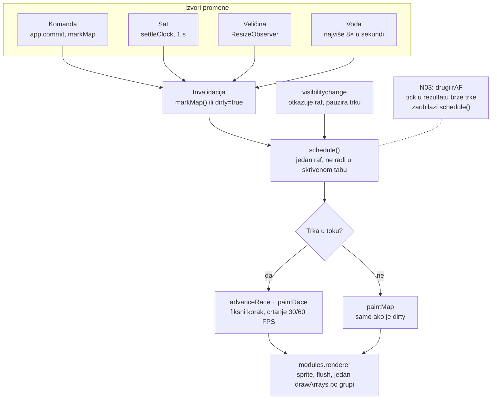

# SC-REND-01 — Čist kod i render: bez gomilanja, ponavljanja, invalidacija i kontradikcija

> **Kopija za `tihidon/test1` (0.8.92-css-unified-p1).** Izvor: [snail-city-test@12f986c](https://github.com/tihidon/snail-city-test/blob/12f986c/docs/tehnika/standardi/SC-REND-01-CIST-KOD-I-RENDER.md) (grana otvorenog PR #12). Provereno prema test1 `main` `2d66e55` (`index.html` SHA-256 `c19cc1ac…`) 25.11.2026: dokument je i pisan nad test1; ponovo potvrđeni ratchet (`counts.sh` → RATCHET PASS prema baseline 0.8.92), N12 (`this.lost=false` posle petlje `uploadSky`), N01 (`commit()` → `Date.now()`), 5 izvršnih blokova. **Ispravljena dva netačna podatka:** broj verzijskih tačaka (šest, ne tri) i pozitivan nalaz: van compositora animiraju 3, ne 2 od 26 `@keyframes` (i `logo-fill` animira `clip-path`). Izmene u odnosu na izvor: ispravke u §0, §6 (N11, keyframes) i §10; uputstvo za pokretanje alata u §7. Pregled svih kopija: [docs/README.md](../../README.md).

**Oznaka:** SC-REND-01 · **Revizija:** 1.1 · **Datum:** 25.11.2026.
**Status:** USVOJENO 25.11.2026. (odluka vlasnika). Dokument i statički pregled; **runtime igre nije menjan, verzija igre se ne podiže** (SC-RAD-01 R05).
**Izvor istine:** ovaj fajl (red 4 u hijerarhiji [SC-RAD-01 §2](./SC-RAD-01-POSTAVKA-IZMENA-BRISANJE.md#2-hijerarhija-autoriteta)). Radna kopija za pregled vlasnika postoji u Claude Docs; izmena važi tek kada uđe u ovaj fajl kroz PR.
**Modalitet:** **MORA** = uslov prihvatanja · **ZABRANJENO** = blokira merge · **PREPORUČENO** = kada se uklapa.

Ovaj vodič popunjava rupe koje preostali standardi ne pokrivaju: **render petlja, GPU resursi, invalidacija prikaza i keša, izvor vremena i smer zavisnosti**, plus merljiva ograničenja za četiri greške — gomilanje, ponavljanje, invalidaciju i kontradikciju.

## Sadržaj

0. [Status, identitet i opseg](#0-status-identitet-i-opseg)
1. [Četiri zabrane: definicija, merenje, prag](#1-četiri-zabrane-definicija-merenje-prag)
2. [Tok invalidacije i crtanja](#2-tok-invalidacije-i-crtanja)
3. [Render vodič (RN01–RN12)](#3-render-vodič-rn01rn12)
4. [Stanje, vreme i smer zavisnosti (T01–T06)](#4-stanje-vreme-i-smer-zavisnosti-t01t06)
5. [Izvedeni keš i invalidacija (I01–I05)](#5-izvedeni-keš-i-invalidacija-i01i05)
6. [Registar nalaza (N01–N12)](#6-registar-nalaza-n01n12)
7. [Ratchet metrike i provera](#7-ratchet-metrike-i-provera)
8. [Kandidati za raščišćavanje](#8-kandidati-za-raščišćavanje)
9. [Kontrolna lista za PR (render i stanje)](#9-kontrolna-lista-za-pr-render-i-stanje)
10. [Status isporuke i otvoreno](#10-status-isporuke-i-otvoreno)
11. [Izvori](#11-izvori)

## 0. Status, identitet i opseg

**Pregledani build (repo `tihidon/test1`, grana `main`):**

| Stavka | Vrednost |
| --- | --- |
| Commit | `2d66e558b48f28071991bc7b334b53fcc07f38a9` (25.11.2026. 00:22 CET) |
| `index.html` SHA-256 | `c19cc1ac…b7c5d` — isti bajtovi kao `test-2/dist` (kandidat v0.8.92-css-unified-p1) |
| Verzija u kodu | `const VERSION = '0.8.92-css-unified-p1'`, naslov `Snail City 0.8.92` |
| `sw.js` | `CACHE_NAME = 'snail-city-shell-0.8.92-css-unified-p1-r2'` |
| Raspored | `index.html`, `sw.js`, `manifest.webmanifest`, `_headers`, `img/` (3 ikonice), `privacy.html`, `delete-account.html`, `docs/` |
| `version.json` | **ne postoji** u test1; verzija je na šest mesta u `index.html` i `sw.js` (ispravka 25.11.2026, ranije „3 tačke“; vidi [SC-RAD-01 §3](./SC-RAD-01-POSTAVKA-IZMENA-BRISANJE.md#3-činjenice-o-kodu-koje-agent-mora-znati)) |
| Izvršni kod | 8.332 linije kraće od 20.000 znakova; 23 linije ugrađenih resursa nose 6,77 MB |

**Važenje za `main` 0.8.90 (ovaj repo):** brojevi iz §7 su isti na `main` `1e3258f` (`index.html` SHA-256 `a4d53277…a3bd7`), osim broja verzijskih CSS komentara (52 u 9 `<style>` blokova). N01 i N12 su pojedinačno potvrđeni i na `main`; ostali nalazi verovatno važe, ali nisu pojedinačno provereni.

**Odnos prema postojećim standardima** (ne ponavlja ih):

| Standard | Već pokriva | SC-REND-01 dodaje |
| --- | --- | --- |
| SC-AGENT-01 A06 (projektni dokument) | jedan rAF, render bez logike, contextlost, budžet tekstura (opšte) | konkretna pravila RN01–RN12 vezana za `schedule`/`loop`/`modules.renderer` |
| [SC-CODE-01](./SC-CODE-01-CSS-DOM-FUNKCIJE.md) | oblik CSS/DOM/funkcija, ratchet alat | ratchet metrike za render, vreme i duplikate helpera (§7) |
| [SC-RAD-01](./SC-RAD-01-POSTAVKA-IZMENA-BRISANJE.md) | postavka, izmena, brisanje | registar keševa i invalidatora (§5) |
| SC-FUNC-01 §5 (projektni dokument) | kontradikcije K01–K08 | nalazi N01–N12 (§6), bez preklapanja |
| [SSOT](./PRAVILO-JEDAN-IZVOR-ISTINE.md) | vlasnici podataka | jedan izvor za vreme, reduced-motion i stanje ekrana koje render čita |

Ako ovo pravilo protivreči PL-01, CSS-01, SSOT ili PW-01, važi stariji specijalizovani standard, a konflikt se upisuje u PR.

<sub>[↑ Sadržaj](#sadržaj)</sub>

## 1. Četiri zabrane: definicija, merenje, prag

Svaka zabrana ima proverljivu definiciju i broj koji sme samo da pada (ratchet, §7). Primeri su iz test1.

| Zabrana | Definicija | Kako se meri | Prag za nov/menjan kod | Primer u test1 |
| --- | --- | --- | --- | --- |
| **G — Gomilanje** | nova izmena se dodaje *preko* postojeće umesto da je zameni („patch na patch“) | CSS sekcije označene verzijom; isti selektor definisan više puta; više lista sa istom svrhom | 0 novih verzijskih sekcija; 0 novih ponovljenih selektora; nova svrha ide u postojeću listu | 51 CSS komentar sa oznakom verzije (`0.8.11`, `v174`, `0.8.2b`…); `.navigation{` 6×, `.island-goal{` 6×, `.wallet button{` 6× |
| **P — Ponavljanje** | ista logika napisana dva ili više puta, makar u drugom obliku | ručno + `git grep` po ponašanju, ne samo po imenu | 0 novih duplikata; drugi korisnik → izdvajanje u postojećeg vlasnika | `clip()` i `clamp()` (isti posao, 2 modula); 3 kopije upload-a teksture; 3 kopije „zameni atlas → nacrtaj → vrati“ |
| **I — Invalidacija** | izvedena vrednost (keš, tekstura, DOM, frejm) ostane zastarela posle promene izvora, ili se osvežava bez potrebe | registar keševa (§5): svaki keš ima izvor, invalidator i test | svaki nov keš upisan u registar u istom PR-u; nema crtanja bez `dirty` | posle `webglcontextrestored` slike neba se ne vraćaju, jer `uploadSky` odbija rad dok je `lost` još `true` (N12) |
| **K — Kontradikcija** | dva izvora za istu činjenicu daju različit odgovor (kod↔kod, kod↔dokument, dokument↔dokument) | tabela nalaza (§6) sa sidrom i dokazom | 0 novih; svaka postojeća ima vlasnika rešenja | prikaz koristi `nowBound()`, komanda `Date.now()` (N01); `reduceMotion` jednom pri pokretanju, renderer `matchMedia` u svakom frejmu (N02) |

**Pravilo razlike:** nešto nije duplikat samo zato što ima isto ime u drugom modulu (`app.commit` ≠ storage `commit`, SC-F01). Duplikat je ista *odgovornost*, proverena čitanjem oba tela.

**Pravilo dokaza:** nula pogodaka pretrage važi samo uz kontrolni pogodak iste komande ([SC-RAD-01 §6](./SC-RAD-01-POSTAVKA-IZMENA-BRISANJE.md#6-brisanje-dokaz-po-vrsti)). Isto važi za alate: nula nalaza bez broja skeniranih fajlova nije dokaz (vidi legacy-scan u §6). Statički broj nije merenje performansi.

<sub>[↑ Sadržaj](#sadržaj)</sub>

## 2. Tok invalidacije i crtanja

Svi izvori promene stižu u jednu invalidaciju, a crtanje pokreće samo `schedule()`; jedino odstupanje je drugi rAF u rezultatu brze trke (N03).



Crtanje ne menja stanje (RN03); tekstura samo kroz `upload()` (RN05).

<sub>[↑ Sadržaj](#sadržaj)</sub>

## 3. Render vodič (RN01–RN12)

Postojeći render je dobar temelj: jedan `schedule()` sa jednim `raf`, crtanje na zahtev preko `dirty`, deljeni `Float32Array` vertex bafer, `flush()` sa jednim `drawArrays` po grupi, `webglcontextlost` sa `preventDefault()`. Pravila ispod čuvaju taj obrazac i zatvaraju mesta gde od njega odstupa.

**RN01 — Jedan rAF (MORA).** Ceo prikaz ide kroz `schedule()` → `loop()`. ZABRANJENO: nov `requestAnimationFrame` van `loop`. Danas postoje 4 pogotka: 1 komentar, 1 u `schedule` i **2 u animaciji rezultata brze trke** (`tick` u prikazu `quickRace`) — to je drugi rAF lanac (N03). DOM animacija koja ne crta na canvas ide u CSS (`transform`/`opacity`, SC-CODE-01 C08) ili se registruje kao dokumentovan izuzetak sa vlasnikom i prekidom.

**RN02 — Crtanje samo posle invalidacije (MORA).** Prikaz se menja samo pozivom `markMap()` ili `dirty=true; schedule()` (danas 13 + 13 mesta). ZABRANJENO: direktan poziv `paintMap`/`paintRace` van `loop`, i periodično crtanje bez promene. Jedini dozvoljeni periodični okidač je voda (najviše 8×/s preko `waterWakeTimer`); nov okidač mora imati sopstveni limit i uslov gašenja.

**RN03 — Paint funkcije su čiste (MORA).** `paintMap` i `paintRace` čitaju stanje i crtaju; ne pišu u `s`, ne zovu `applyCommand`, ne diraju DOM i ne pokreću tajmere (SC-F03, A06). Vraćaju samo `painted` (boolean).

**RN04 — Bez upita okruženju po frejmu (MORA).** U `loop` i paint putanji ZABRANJENO: `matchMedia()`, `getComputedStyle`, `getBoundingClientRect`, `classList.contains` na `body`, `gl.getError/getParameter/readPixels` (MDN: blokirajući pozivi). Vrednost se čita jednom i osvežava događajem (`MediaQueryList` `change`, `ResizeObserver`). Odstupanja danas: `matchMedia` u `drawIllustratedMap` svakim frejmom (N02); tri `document.body.classList.contains(...)` u `loop` za vodu (N07). `getParameter` postoji samo u dijagnostici izveštaja — to je ispravno.

**RN05 — Jedan put za GPU teksturu (MORA).** Svaka tekstura ide kroz `renderer.upload(key, image)` i živi u mapi `textures`; brisanje kroz `releaseTexture`. ZABRANJENO: nova funkcija koja ponavlja `createTexture` → `texImage2D` → 4× `texParameteri`. Danas isti niz postoji u `upload`, `uploadIllustratedMap` i `uploadDetachedAtlas` (N04).

**RN06 — Promena GPU stanja se vraća na jednom mestu (MORA za nov kod).** Obrazac „`flush()` → zameni `atlas` → `bindTexture` → nacrtaj → `flush()` → vrati atlas i teksturu“ piše se jednom, kao pomoćna metoda renderera sa `try/finally`. Danas je ponovljen u `drawSky`, `drawIllustratedMap` i `drawDetachedObjects` (N05); zaboravljen korak ostavlja pogrešnu teksturu za sledeći sprite.

**RN07 — Veličina canvasa (MORA).** Veličina se menja kroz postojeći `resize()` → `renderer.resize()`, koji već preskoči iste dimenzije. Po MDN-u promena veličine briše canvas, a `ResizeObserver` callback ide posle rAF callback-a; zato je ciljni redosled „primeni novu veličinu na početku sledećeg `loop`-a, pa crtaj“. Danas se veličina primenjuje u observer callback-u, pa crtanje stiže tek u sledećem frejmu (RK9, nije potvrđen vidljiv kvar). DPR ide samo kroz `selectRatio()`; ZABRANJENO drugo čitanje `devicePixelRatio` za crtanje.

**RN08 — Bez alokacija u vrućoj putanji (MORA za nov kod).** U `loop`/paint: bez novih nizova, objekata, closure-a, `structuredClone`, string konkatenacije za ključeve i dekodiranja slika. Koristi postojeći `renderer.data` bafer i keš instanci (`scBuildVisualInstances`). Upload tekstura nikad usred crtanja (MDN).

**RN09 — Budžet draw poziva (MORA za nov vizuelni efekat).** Nov efekat crta kroz postojeći `sprite()`/`flush()` i atlas, ne kroz sopstveni program ili canvas. PR navodi `renderer.stats.calls` i `stats.upload` pre i posle za isti kadar; rast mora biti obrazložen.

**RN10 — Pozadina i vidljivost (MORA).** Jedan `visibilitychange` rukovalac već otkazuje rAF, pauzira trku i zvuk. Nov rad koji troši CPU/GPU se registruje u tom rukovaocu, ne u novom. Real-time ekonomija ostaje tačna jer se računa iz rokova (§4).

**RN11 — Jedan izvor za smanjeno kretanje (MORA).** Postoji jedna vrednost u `app`-u, ažurirana `change` događajem; renderer je dobija kao parametar, kao što `paintRace(renderer, race, !reduceMotion)` već radi. CSS koristi `@media (prefers-reduced-motion: reduce)`. Danas: konstanta pri pokretanju + poseban upit u rendereru (N02).

**RN12 — Canvas 2D fallback ima isti ugovor (MORA).** Svaka metoda renderera radi i bez `gl` (kao `drawSky`/`drawIllustratedMap` već rade preko `ctx.drawImage`), ili jasno vraća `false`. Nov efekat se proverava u oba backend-a; Canvas 2D/SwiftShader ne dokazuje performanse Android GPU-a (A06).

<sub>[↑ Sadržaj](#sadržaj)</sub>

## 4. Stanje, vreme i smer zavisnosti (T01–T06)

**T01 — Jedan izvor vremena igre (MORA).** Vreme igre daje `nowBound()` (`Date.now()` + test pomak, nikad manje od `s.lastAt`). Prikaz, `settleClock` i komanda moraju dobiti isto vreme. ZABRANJENO: `Date.now()` u novom kodu `app`/`ui`/`scenes` za odluke o igri. Danas `commit()` šalje `applyCommand(…, Date.now())`, a prikaz koristi `nowBound()` — u test režimu sa pomakom sata prikaz i komanda se ne slažu (N01). `Date.now()` ostaje dozvoljen za `uuid`, analitiku i metrike.

**T02 — Vreme simulacije nije vreme igre (MORA).** Trka koristi rAF vremensku oznaku i fiksni korak (`advanceRace` sa ograničenjem 100 ms). `performance.now()` (`baseTime`) služi samo za merenje. Real-time tajmeri (jaje, uzgoj, žetva) su apsolutni rokovi u stanju (SC-RAD-01 P02), nikad brojač.

**T03 — Slučajnost se ubacuje (MORA za domen).** `applyCommand(current, cmd, now, random)` već prima `random`; nova domenska funkcija koja koristi slučajnost prima isti parametar, ne zove `Math.random()` direktno, da bi null test trke (25%) i reprodukcija bili mogući. Kozmetička slučajnost u UI-ju (položaj meteora) je dozvoljena.

**T04 — Stanje ekrana ne živi u DOM klasama (MORA za nov kod).** Klase na `body` (`screen-open`, `editing-island`, `booting`, `in-race`) su **prikaz** stanja, ne izvor. Kod koji odlučuje (render, input, tajmeri) čita promenljivu stanja aplikacije, a klasu postavlja jedan vlasnik. Danas `loop` odlučuje o vodi čitanjem tri klase sa `body` (N07).

**T05 — Smer zavisnosti (MORA).** Dozvoljen smer: `app` → `ui`/`scenes`/`domain`/`storage`; `scenes` → `renderer`; `domain` → `catalog`/`progression`. ZABRANJENO u novom kodu: `domain` → `scenes`/`ui`/`renderer`, `renderer` → `domain`, `storage` → `ui`. Danas `applyCommand` dva puta zove `modules.scenes.prepareIsland(s)` (na ulazu i pri promeni nivoa) — domen zavisi od modula scena, a normalizacija rasporeda ostrva živi u modulu prikaza (N08). Ne premešta se usput (RK8).

**T06 — Jedna komanda, jedna kopija stanja (MORA).** Komanda radi nad `structuredClone(current)` i vraća novo stanje. `s` zamenjuju samo `app.commit`, `replaceSave` (uvoz/oporavak) i `devAction` (test režim); nov pisac `s` je ZABRANJEN. ZABRANJENO: mutacija `s` iz UI-ja ili paint funkcije. `mapObjects` i `placementRules` rade `structuredClone(s)` + `prepareIsland` kada `islandLayout !== 9` — to je dozvoljeno samo kao zaštita za stari raspored koji `boot` već normalizuje jednom; nov `structuredClone` u putanji prikaza je ZABRANJEN (RN08).

<sub>[↑ Sadržaj](#sadržaj)</sub>

## 5. Izvedeni keš i invalidacija (I01–I05)

Keš je dozvoljen samo kao obnovljiva kopija vlasničkog podatka (SSOT, SC-F02). Svaki keš mora imati red u registru ispod; nov keš bez reda je ZABRANJEN.

**I01 — Ključ nosi ceo izvor (MORA).** Keš se poništava kada se promeni bilo šta od čega zavisi. Ključ po identitetu niza (`objects===cached.objects`) važi samo ako svaka izmena pravi nov niz — to mora biti zapisano kod vlasnika.

**I02 — Jedan invalidator po kešu (MORA).** Za keš mape to je `markMap()`; za GPU to su `upload`/`releaseTexture` i rukovalac `webglcontextrestored`. ZABRANJENO: ručno brisati keš iz UI-ja ili drugog modula.

**I03 — Gubitak konteksta poništava sve GPU ručke i sve ih vraća (MORA).** `initGL()` već prazni `textures`, `mapTexture`, `detachedTexture` i `skyTextures` — to je jedini invalidator i ne duplira se. Sve što prikaz koristi mora se posle toga ponovo poslati ili poslati pri prvoj upotrebi; svaka funkcija slanja koja proverava `lost` poziva se tek kad je `lost` vraćen na `false` (N12).

**I04 — Keš nije save autoritet (MORA).** Ništa iz ovog registra se ne upisuje u IndexedDB niti šalje u cloud; posle reload-a se gradi iz stanja.

**I05 — Ograničen rast (MORA za nov keš).** Nov keš ima gornju granicu ili konačan skup ključeva (npr. broj atlasa). Keš po vremenu ili po unosu igrača bez granice je ZABRANJEN.

| Keš (sidro) | Vlasnik | Izvor | Invalidator | Status |
| --- | --- | --- | --- | --- |
| `objects`, `paintedWheatStage` | `app` | `mapObjects(s, nowBound())` | `markMap()` | u redu |
| `scVisualCache` | `scenes` | identitet niza `objects` | nov niz iz `markMap()` | proveriti sve pisce (SC-FUNC-01 K07) |
| `scMapSignCache` | `scenes` | `artRects`, potpis, ključevi natpisa | poređenje pri crtanju | u redu |
| `renderer.textures` | `renderer` | `renderer.images` | `initGL()` (prazni sve), `upload`, `releaseTexture` | u redu za atlase; nebo se ne vraća (**N12**) |
| `renderer.images` / `pending` | `renderer` | ugrađeni WebP blokovi | nikad (žive koliko aplikacija) | u redu; atlas trke se oslobađa kroz `releaseTexture` |
| `COLORS`, `roadPalettes` | `renderer` / `scenes` | konačan skup boja | ne treba | u redu |
| i18n `memo`, `sources`, `attributes` | `i18n` | `EN_DICTIONARY` + DOM | `WeakMap` prati život čvora | u redu |
| `view.viewKey` | `ui` | otvoren ekran | `viewKey=null` (9 mesta) | 9 ručnih invalidacija: kandidat za jedno mesto u `openScreen`/`dismiss` |
| `reduceMotion` | `app` | `prefers-reduced-motion` | **nema** (čita se jednom) | **kontradikcija N02** |
| CacheStorage `CACHE_NAME` | `sw.js` | `CORE_PATHS` | promena `CACHE_NAME` + `OWNED_PREFIXES` | PW-01; ne dirati bez izmene izvršnog koda |

<sub>[↑ Sadržaj](#sadržaj)</sub>

## 6. Registar nalaza (N01–N12)

Jedanaest važećih statičkih nalaza u test1 (N01–N08, N10–N12), bez preklapanja sa SC-FUNC-01 K01–K08 i SC-CODE-01 §3; N09 je povučen posle ponovne provere. Nijedan nije potvrđen pokretanjem igre; „rizik“ znači da kod dozvoljava grešku, ne da je viđena. Sidra su imena funkcija i nizovi, ne brojevi linija (SC-RAD-01 §3).

| ID | Vrsta | Dokaz (sidro u `index.html`) | Posledica | Težina | Kandidat |
| --- | --- | --- | --- | --- | --- |
| N01 | K kod↔kod | `commit()` → `applyCommand(s,{…},Date.now())`; prikaz i `markMap` koriste `nowBound()` sa `testClockShift` | u test režimu sa pomakom sata ekran kaže „spremno“, a komanda radi po pravom vremenu; redovna igra nije pogođena jer `applyCommand` ionako uzima `max(lastAt, now)` | P2 | RK2 |
| N02 | K kod↔kod | `const reduceMotion=globalThis.matchMedia?.(…).matches` jednom; `drawIllustratedMap` zove `matchMedia(…)` u svakom frejmu | promena podešavanja tokom igre: voda prati novu vrednost, trka i petlja staru; upit okruženja u vrućoj putanji | P2 | RK1 |
| N03 | K kod↔standard | prikaz rezultata brze trke: `const tick=now=>{…requestAnimationFrame(tick)}` | drugi rAF lanac pored `schedule()`; svakim frejmom `$('qr-bars')` pretraga DOM-a; ne zaustavlja se kroz `visibilitychange` rukovalac | P2 | RK6 |
| N04 | P | `upload`, `uploadIllustratedMap`, `uploadDetachedAtlas`: isti niz `createTexture` → `texImage2D` → 4× `texParameteri` | promena filtera ili formata mora se uraditi na 3 mesta; dve od tri teksture su van mape `textures` i van `releaseTexture` | P2 | RK4 |
| N05 | P | `drawSky`, `drawIllustratedMap`, `drawDetachedObjects`: `flush` → zameni `atlas` → `bindTexture` → crtaj → `flush` → vrati | izuzetak između koraka ostavlja pogrešan atlas/teksturu za ostatak frejma (nema `finally`) | P2 | RK5 |
| N06 | P | `const clip = (value,min,max)=>…` i `const clamp=(v,a,b)=>…` | dva imena za istu funkciju u dva modula | P3 | RK10 |
| N07 | T04 | `loop`: `document.body.classList.contains('screen-open' / 'editing-island' / 'booting')` | odluka o crtanju zavisi od DOM klasa; 3 DOM čitanja po frejmu na ostrvu | P2 | RK7 |
| N08 | arhitektura | `applyCommand` → `modules.scenes.prepareIsland(s)` (2×); `mapObjects`/`placementRules` → `structuredClone(s)` + `prepareIsland` | domen zavisi od modula prikaza; pravilo rasporeda ostrva ima vlasnika u `scenes`, a menja stanje | P2 | RK8 |
| ~~N09~~ | povučeno | `initGL()` na početku rukovaoca `webglcontextrestored` već prazni `textures`, `mapTexture`, `detachedTexture`, `skyTextures`; `preload` zatim ponovo šalje atlas staze | prvobitna tvrdnja o „starim ručkama“ bila je pogrešna: proveren je samo rukovalac, ne i `initGL()` | — | — |
| N10 | G | 51 CSS komentar sa verzijom; `.navigation{` 6× (jedan sa `!important` iz 0.8.12); sakrivanje HUD-a u dve paralelne liste: 5 pravila `.in-race …{display:none}` i 4 pravila `.screen-open …{display:none}` | nov HUD element mora se dopisati u više lista; zaboravljen unos ostavlja element vidljiv tokom trke ili ekrana | P2 | RK11 |
| N11 | K dok↔kod | SC-CODE-01 Dodatak A naveo je samo `CACHE_NAME …-r1` (ZIP kandidat); test1 ima `…-r2`. SC-RAD-01 §3: 4 verzijske tačke sa `version.json`; test1 nema `version.json` (verzija na šest mesta, ne tri — ispravka 25.11.2026) | agent koji radi po dokumentu proverava pogrešan inventar; `verify_edit.py` K2 na test1 daje FAIL („nije pronađeno: version.json“) — provereno 25.11.2026 | P2 | ispravljeno u SC-CODE-01 i SC-RAD-01 (odluka 2) |
| N12 | I | rukovalac `webglcontextrestored`: `uploadSky` se zove pre `this.lost=false`, a `uploadSky` počinje sa `if(!this.gl\|\|this.lost)return;` | posle gubitka i vraćanja GPU konteksta `skyTextures` ostaje prazan; `drawSky` vraća `false` i ostrvo se crta bez slike neba (samo boja pozadine) do ponovnog učitavanja | P2 | RK3 (samo dokumentovano, odluka vlasnika) |

**Pozitivni nalazi (zadržati):** jedan `schedule()`/`raf`, crtanje na `dirty`, vodeni okidač ograničen na 8×/s, `visibilitychange` gasi rAF i pauzira trku, `webglcontextlost` sa `preventDefault()`, `getParameter` samo u dijagnostici, deljeni `Float32Array` bafer, shaderi obrisani posle linkovanja, 82 poziva jednog `escapeHtml`, 3 od 26 `@keyframes` animiraju svojstva van `transform`/`opacity`: `sc079-ready-glow` (`box-shadow`, `filter`), `sc079-claim-glow` (`filter`) i `logo-fill` (`clip-path`, logo pri pokretanju) — ispravka 25.11.2026, ranije je navedeno 2.

**legacy-scan (modern-web-guidance 1.0.2, 38 vodiča, 52 pravila):** 6 nalaza, svi pravilo `js/copying-array-methods` — `list.slice().sort(…)` i `slice().reverse()` mogu biti `toSorted()`/`toReversed()` (sortiranje puževa, muzej, `values.slice().sort`). P3, bez uticaja na rad; menjati samo uz proveru da ciljni pregledači podržavaju ES2023 (SC-AGENT-01 §17: ne uvoditi API samo zato što je moderan). **Pouka za metod:** prvo pokretanje nad `index.html` vratilo je „0 nalaza“ jer alat preskoči fajlove veće od 1.000.000 B; tačan rezultat dobijen je tek nad izdvojenim skriptama i CSS-om bez ugrađenih resursa (6 fajlova skenirano). Nula iz alata bez broja skeniranih fajlova nije dokaz.

<sub>[↑ Sadržaj](#sadržaj)</sub>

## 7. Ratchet metrike i provera

Dvanaest brojeva dopunjuje 18 metrika SC-CODE-01 §8; svi smeju samo da padaju ili ostanu isti. Polazna stanja su izmerena alatom [`tools/sc-rend-01/counts.sh`](https://github.com/tihidon/snail-city-test/blob/12f986c/tools/sc-rend-01/README.md) 25.11.2026.

| Metrika | 0.8.90 (`main`) | 0.8.92 (test1) | Pravilo | Cilj posle kandidata |
| --- | ---: | ---: | --- | ---: |
| `rafCalls` (pozivi, bez komentara) | 3 | 3 | RN01 | 1 (RK6) |
| `matchMediaCalls` | 2 | 2 | RN04, RN11 | 1 (RK1) |
| `dateNowCalls` | 10 | 10 | T01 | 9 (RK2) |
| `texImage2DSites` | 3 | 3 | RN05 | 1 (RK4) |
| `createTextureSites` | 3 | 3 | RN05 | 1 (RK4) |
| `bodyClassReads` | 3 | 3 | T04, RN04 | 0 (RK7) |
| `structuredClone` | 7 | 7 | T06 | ≤ 7 |
| `viewKeyResets` | 9 | 9 | I02 | ≤ 9 |
| `clampHelpers` | 2 | 2 | P | 1 (RK10) |
| `cssVersionComments` | 52 | 51 | G | ≤ polazno; nov 0 |
| `cssHideInRace` | 5 | 5 | G | 1 (RK11) |
| `cssHideScreenOpen` | 4 | 4 | G | 1 (RK11) |

**Za test1:** komande su u [SC-CODE-01 §8](./SC-CODE-01-CSS-DOM-FUNKCIJE.md#8-alat-i-ratchet-provera) (blok „Za test1“).

```bash
tools/sc-rend-01/counts.sh index.html tools/sc-rend-01/baseline-0.8.90.txt
# izlaz 0 = RATCHET PASS, 1 = RATCHET FAIL (ispisuje šta je poraslo), 2 = upotreba ili kontrolni pogodak
```

Alat preskače linije ugrađenih resursa i prekida rad ako kontrolni pogodak (`function schedule(`) nije tačno 1. Kandidat se meri prema baseline-u **svoje** polazne verzije; baseline se ažurira samo u PR-u prihvaćenog kandidata za raščišćavanje, nikad da bi prošla nova funkcionalnost.

**Ograničenja:** broji tekst, ne izvršavanje; ne vidi imena sklopljena u runtime-u; `shellcheck` nije bio dostupan u okruženju pregleda (NIJE PROVERENO), a `bash -n` i tri slučaja (PASS, FAIL, kontrola) jesu — u [README alata](https://github.com/tihidon/snail-city-test/blob/12f986c/tools/sc-rend-01/README.md).

<sub>[↑ Sadržaj](#sadržaj)</sub>

## 8. Kandidati za raščišćavanje

Prvo RK1 i RK2 (jeftini, nizak rizik); RK3 je po odluci vlasnika samo dokumentovan, bez izmene koda; RK8 i RK9 poslednji. Svaki kandidat je **zaseban PR** sa jednim ciljem, verzijom podignutom na svim tačkama, PW-01 regresijom i Chromium screenshot-om pre/posle (SC-AGENT-01 G1–G3). Nijedan nije odobren ovim dokumentom.

| Red | ID | Nalaz | Najmanja izmena | Rizik | Dokaz za prihvatanje |
| ---: | --- | --- | --- | --- | --- |
| 1 | RK1 | N02 | jedan `MediaQueryList` u `app`, `change` ažurira vrednost; renderer je dobija kao parametar | nizak | DevTools emulacija reduced-motion tokom igre: voda i trka menjaju se zajedno |
| 2 | RK2 | N01 | `commit()` šalje `nowBound()` umesto `Date.now()` | nizak; samo test režim menja ponašanje | test režim, pomak sata, leganje jajeta: prikaz i komanda se slažu; redovna igra isti `revision` |
| 3 | RK3 | N12 | u rukovaocu `webglcontextrestored` postaviti `this.lost=false` pre petlje `uploadSky` (jedna premeštena linija) | nizak | **odluka vlasnika 25.11.2026: samo dokumentovano, kod se ne menja**; test kada se odobri: `WEBGL_lose_context` gubitak/vraćanje, nebo vidljivo bez reload-a |
| 4 | RK4 | N04 | `uploadIllustratedMap`/`uploadDetachedAtlas` pozivaju jednu internu funkciju za kreiranje teksture | nizak | pixel-diff 0 ostrva; isti `stats.upload` |
| 5 | RK5 | N05 | jedna metoda „privremeni atlas“ sa `try/finally` za 3 mesta | srednji: redosled bind-a | pixel-diff 0 ostrva i neba; `stats.calls` isti |
| 6 | RK6 | N03 | animacija traka rezultata u CSS (`transform: scaleX`), ili izuzetak upisan u SSOT sa prekidom na zatvaranju | srednji: izgled | GIF realnih frejmova pre/posle („Pogledaj kretanje“); reduced-motion odmah konačno stanje |
| 7 | RK7 | N07 | `loop` čita postojeće stanje aplikacije (otvoren ekran, uređivanje, boot) umesto `body` klasa | srednji | voda se gasi/pali isto pri otvaranju ekrana, uređivanju i boot-u |
| 8 | RK10 | N06 | jedno ime (`clip` ili `clamp`) u zajedničkom modulu | nizak | `node --check`, testovi trke i ekonomije |
| 9 | RK11 | N10 | jedna klasa stanja (npr. `hud-hidden`) i jedna lista elemenata HUD-a, posle SC-CODE-01 K1 | visok: kaskada | računati stil i pixel-diff svih ekrana iz SC-CODE-01 A.4, u trci i sa otvorenim ekranom |
| 10 | RK9 | RN07 | primena nove veličine canvasa na početku `loop`-a umesto u `ResizeObserver` callback-u | visok: PL-01 | A/B/R po PL-01 (20–30 ponavljanja), rotacija ekrana bez praznog frejma |
| 11 | RK8 | N08 | normalizacija rasporeda ostrva prelazi u domen/migraciju; `scenes` samo čita | visok: sejv | proširi → prebaci → suzi (SC-RAD-01 R07), test sa starim snimkom, PW-01 |

**Ne raditi:** spajanje RK-ova u jedan PR, uklanjanje vodenog efekta ili senki radi brojeva, nov renderer/framework, izmena `CACHE_NAME` bez izmene izvršnog koda.

<sub>[↑ Sadržaj](#sadržaj)</sub>

## 9. Kontrolna lista za PR (render i stanje)

Dopunjuje [SC-CODE-01 §9](./SC-CODE-01-CSS-DOM-FUNKCIJE.md#9-kontrolna-lista-za-pr) i [SC-RAD-01 §7](./SC-RAD-01-POSTAVKA-IZMENA-BRISANJE.md#7-kontrolna-lista-za-pr); ne ponavlja njihove stavke.

- [ ] RN01/RN02: nema novog `requestAnimationFrame`; svaka promena prikaza ide kroz `markMap()` ili `dirty=true; schedule()`.
- [ ] RN03: `paintMap`/`paintRace` i nove paint funkcije ne pišu stanje, DOM ni tajmere.
- [ ] RN04/RN08: u `loop` i paint putanji nema `matchMedia`, DOM čitanja, `structuredClone`, novih nizova ni dekodiranja.
- [ ] RN05/RN06: tekstura ide kroz `upload`; promena atlasa/bind-a ima jedno mesto vraćanja.
- [ ] RN09: `renderer.stats.calls` i `stats.upload` pre/posle istog kadra navedeni u PR-u.
- [ ] RN12: nov efekat proveren u WebGL i Canvas 2D putanji.
- [ ] T01: odluke igre koriste `nowBound()`; `Date.now()` samo za id, analitiku i metrike.
- [ ] T03: domenska slučajnost dolazi kroz parametar `random`.
- [ ] T04/T05: render i domen ne čitaju DOM klase; nema nove zavisnosti `domain` → `scenes`/`ui`/`renderer`.
- [ ] I01–I05: svaki nov keš upisan u registar §5 sa izvorom, invalidatorom i granicom.
- [ ] §7: izlaz `counts.sh … baseline` u PR-u: RATCHET PASS.
- [ ] G/P/K: nema nove verzijske CSS sekcije, nove liste sa istom svrhom ni drugog izvora za postojeću činjenicu.

<sub>[↑ Sadržaj](#sadržaj)</sub>

## 10. Status isporuke i otvoreno

| Stavka | Status | Dokaz / razlog |
| --- | --- | --- |
| Statički pregled test1 (render, vreme, keš, CSS slojevi) | URAĐENO | commit `2d66e55`, SHA-256 `c19cc1ac…`; komande u §7 |
| Pravila RN01–RN12, T01–T06, I01–I05 | URAĐENO | §3–§5 |
| Registar nalaza i kandidati | URAĐENO | §6, §8; N09 povučen, N12 dodat posle ponovne provere |
| Usvajanje i mesto u repou (odluka 1) | URAĐENO | ovaj fajl, veze iz `AGENTS.md` i indeksa |
| Ispravka N11 u SC-CODE-01 i SC-RAD-01 (odluka 2) | URAĐENO | isti PR |
| RK3 (odluka 3) | NIJE URAĐENO — namerno | ponovna provera povukla je N09; za pravi kvar (N12) vlasnik je odlučio: samo dokumentovati |
| `legacy-scan` (odluka 4) | URAĐENO | 6 nalaza `js/copying-array-methods`, §6; prvi prolaz bio je lažna nula zbog granice od 1 MB |
| Ratchet alat u repou | URAĐENO | `tools/sc-rend-01/` + polazna stanja 0.8.90 i 0.8.92 |
| Pokretanje igre, Chromium screenshot, context-loss test | NIJE URAĐENO | dokumentaciona isporuka |
| Izmene `index.html`, `sw.js`, sejva, verzije igre | NIJE URAĐENO — namerno | runtime nije menjan |

**Odluke vlasnika (25.11.2026):** 1) SC-REND-01 usvojen, mesto `docs/tehnika/standardi/` uz veze iz `AGENTS.md`; 2) N11 ispraviti u SC-CODE-01 i SC-RAD-01; 3) RK3 odobren, pa posle ispravke nalaza zamenjen odlukom „samo dokumentuj“; 4) `legacy-scan` dozvoljen.

**Otvoreno:**

1. RK3 (nebo posle vraćanja GPU konteksta): pokrenuti kada vlasnik odobri izmenu koda.
2. `verify_edit.py` K2 na buildu bez `version.json` (test1) daje FAIL; da li alat treba da proverava stvarnih šest mesta u test1 (i `SC_PWA_STATUS.version`, koju K2 danas ne vidi ni u 0.8.90) — odluka vlasnika.
3. RK1 i RK2 kao sledeći kandidati (nizak rizik).
4. `counts.sh` kao obavezna CI provera (zaseban PR za workflow, zajedno sa SC-RAD-01 §8 tačka 4).

<sub>[↑ Sadržaj](#sadržaj)</sub>

## 11. Izvori

Provereno 25.11.2026.

- MDN — [WebGL best practices](https://developer.mozilla.org/en-US/docs/Web/API/WebGL_API/WebGL_best_practices): blokirajući `getError`/`getParameter`/`readPixels`; obrada `webglcontextlost`; upload pre crtanja; atlas i manje draw poziva; promena veličine briše canvas, `ResizeObserver` callback ide posle rAF-a, `device-pixel-content-box` (RN04–RN09).
- GoogleChrome — [modern-web-guidance](https://github.com/GoogleChrome/modern-web-guidance): teme `performance` (long tasks, INP), `css` (design tokens), `accessibility`; CLI `search`/`retrieve`/`legacy-scan`.
- Projektni: SC-AGENT-01 (A06, A10, A11), SC-ARCH-01, SC-FUNC-01 (K01–K08, SC-F01–F08) — projektni dokumenti; [SC-CODE-01](./SC-CODE-01-CSS-DOM-FUNKCIJE.md), [SC-RAD-01](./SC-RAD-01-POSTAVKA-IZMENA-BRISANJE.md), [SSOT](./PRAVILO-JEDAN-IZVOR-ISTINE.md), [PL-01/CSS-01](./SC-PL-01-LAYOUT-INVALIDATION-REVIEW-STANDARD.md), [PW-01](https://github.com/tihidon/snail-city-test/blob/1e3258f/docs/tehnika/pwa-offline/SC-v0.8.90-STABLE-PW01-ANDROID.md).
- Kod: [tihidon/test1](https://github.com/tihidon/test1) `main` `2d66e558`; ovaj repo `main` `1e3258f`.

<sub>[↑ Sadržaj](#sadržaj)</sub>
